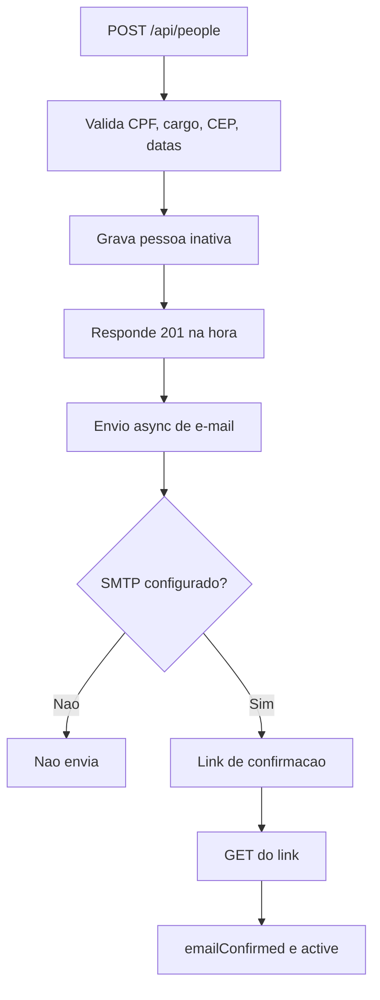

<p align="center">
  
</p>

<h1 align="center">Cadus API</h1>

<p align="center">
  Backend do <strong>cadastro de pessoas</strong> da operação portuária<br />
  Spring Boot, PostgreSQL, MinIO e e-mail de confirmação
</p>

<p align="center">
  
  
  
  <br />
  
  
  
  <br />
  
  
  
</p>

---

## Links

<p align="center">
  <a href="http://localhost:8080/api/people">
    
  </a>
  &nbsp;
  <a href="../frontend">
    
  </a>
</p>

- API local: [http://localhost:8080](http://localhost:8080)
- Pessoas: [http://localhost:8080/api/people](http://localhost:8080/api/people)
- CEP: [http://localhost:8080/api/cep/{cep}](http://localhost:8080/api/cep/01001000)
- Frontend (pasta irmã): `../frontend`. Next.js 16, HeroUI v3 e Bun

---

## Funcionalidades

- **CRUD de pessoas:** CPF, nome, cargo, salário, contrato, contato, endereço, foto e anexos PDF.
- **Filtros:** CPF, nome, faixa salarial e período de contrato (`contractEnd` nulo entra como contrato indeterminado).
- **Cargos da operação:** lista fixa para o select do frontend (`GET /api/people/cargos`).
- **Foto:** upload JPG/PNG/WEBP (até 8 MB) no MinIO; `GET` com `Cache-Control: no-store`.
- **Anexos:** RG, documento de CPF e comprovante de residência (`kind`: `rg`, `cpfDoc`, `residence`).
- **E-mail de confirmação:** envio **assíncrono** após o save; o cadastro não espera SMTP. Sem usuário de e-mail configurado, o envio é ignorado.
- **Anti-enumeração:** falha de SMTP é engolida. A API não revela se a caixa existe.
- **Reenvio:** `POST /api/people/{id}/confirm-email` gera token se faltar e dispara de novo.
- **Ativação:** o clique no link `GET /api/people/confirm/{token}` confirma o e-mail e ativa o cadastro.
- **CEP:** ViaCEP primeiro; se falhar, República Virtual.
- **Validação:** CPF (dígitos verificadores), CEP com 8 dígitos, telefone 10/11, cargo da lista, datas do contrato.
- **Seed:** se a tabela estiver vazia, grava 3 pessoas de demonstração.
- **Segredos fora do Git:** `application.properties` só tem placeholders; valores reais no `.env`.

## Tecnologias utilizadas

- **Spring Boot 4.1.2:** Web MVC, Validation, Security (`permitAll` neste desafio), Mail, Data JPA.
- **Java 21:** records, switch, text blocks, virtual-thread-ready.
- **Maven Wrapper:** `./mvnw`, sem instalar Maven na máquina.
- **PostgreSQL:** persistência (`localhost:9867`, database `cadus`).
- **MinIO + AWS SDK S3 2.33.9:** arquivos em bucket `cadus`, path-style.
- **ViaCEP + República Virtual:** consulta de endereço.
- **Lombok:** getters/setters nas entidades.
- **JUnit 5:** CPF, CEP, mapper, mail, properties sem senha commitada.

## Plataformas

| Superfície | Status |
|------------|--------|
| API HTTP `localhost:8080` | Compatível |
| Frontend Next (`../frontend`) | Compatível (CORS `http://localhost:*`) |
| PostgreSQL `localhost:9867` | Obrigatório |
| MinIO `localhost:9000` | Obrigatório para foto/PDF |
| SMTP Gmail | Opcional |

## Fluxo do cadastro



## API

| Método | Caminho | O que faz |
|--------|---------|-----------|
| `GET` | `/api/people` | Lista com filtros `cpf`, `name`, `salaryMin`, `salaryMax`, `contractStart`, `contractEnd` |
| `GET` | `/api/people/cargos` | Cargos disponíveis |
| `GET` | `/api/people/{id}` | Uma pessoa |
| `POST` | `/api/people` | Cria + enfileira e-mail |
| `PUT` | `/api/people/{id}` | Atualiza |
| `PATCH` | `/api/people/{id}/active` | Ativa / desativa |
| `DELETE` | `/api/people/{id}` | Remove pessoa e arquivos no MinIO |
| `POST` | `/api/people/{id}/photo` | Upload da foto (`multipart` campo `file`) |
| `GET` | `/api/people/{id}/photo` | Bytes da foto |
| `POST` | `/api/people/{id}/attachments/{kind}` | PDF (`rg` \| `cpfDoc` \| `residence`) |
| `GET` | `/api/people/{id}/attachments/{kind}` | Bytes do PDF |
| `POST` | `/api/people/{id}/confirm-email` | Reenvia confirmação |
| `GET` | `/api/people/confirm/{token}` | Confirma e-mail (HTML) |
| `GET` | `/api/cep/{cep}` | Endereço (ViaCEP → República Virtual) |

## Estrutura do projeto

```bash
backend/
│
├── src/main/java/br/com/backend/cadus/
│   ├── CadusApplication.java      # @SpringBootApplication + @EnableAsync
│   ├── config/                    # CORS, Security, MinIO properties
│   ├── common/                    # CPF, CEP, cargos, DataUrls, ApiException
│   ├── infra/
│   │   ├── mail/                  # ConfirmationMailService
│   │   ├── storage/               # MinIO (S3Client path-style)
│   │   └── cep/                   # ViaCEP + República Virtual
│   └── modules/
│       ├── people/                # controller, service, seeder, mapper, entity, dto
│       └── cep/                   # lookup de endereço
│
├── src/main/resources/
│   └── application.properties     # placeholders ${ENV:default}
├── src/test/java/                 # JUnit
├── .env.example                   # modelo sem segredo
├── .env                           # local, gitignored
├── mvnw / mvnw.cmd
├── pom.xml
└── README.md
```

## Instalação

### Pré-requisitos

- **JDK 21** (Temurin / SDKMAN)
- **PostgreSQL** em `localhost:9867`, database `cadus`, user/senha `postgres`
- **MinIO** em `http://localhost:9000` com bucket `cadus`
- (Opcional) senha de app do Gmail para SMTP

### Subir a API

1. **Entre na pasta:**

   ```bash
   cd backend
   ```

2. **Ambiente local:**

   ```bash
   cp .env.example .env
   ```

   Preencha `MINIO_ACCESS_KEY`, `MINIO_SECRET_KEY` e, se for usar e-mail, `MAIL_USERNAME` / `MAIL_PASSWORD` / `MAIL_FROM`.

3. **Rode:**

   ```bash
   ./mvnw spring-boot:run
   ```

   Sobe em `http://localhost:8080`.

4. **Testes:**

   ```bash
   ./mvnw test
   ```

5. **Frontend** (outra pasta):

   ```bash
   cd ../frontend
   bun install
   bun run dev
   ```

## Variáveis de ambiente (`.env`)

| Variável | Padrão | Descrição |
|----------|--------|-----------|
| `DB_URL` | `jdbc:postgresql://localhost:9867/cadus` | JDBC do Postgres |
| `DB_USER` | `postgres` | Usuário |
| `DB_PASSWORD` | `postgres` | Senha |
| `APP_PUBLIC_URL` | `http://localhost:8080` | Base dos links de foto, anexo e confirmação |
| `MAIL_HOST` | `smtp.gmail.com` | SMTP |
| `MAIL_PORT` | `587` | Porta STARTTLS |
| `MAIL_USERNAME` | *(vazio)* | Conta SMTP; vazio = não envia |
| `MAIL_PASSWORD` | *(vazio)* | Senha de app |
| `MAIL_FROM` | *(vazio)* | Remetente (`Cadus <email>`) |
| `MINIO_ENDPOINT` | `http://localhost:9000` | S3/MinIO |
| `MINIO_ACCESS_KEY` | *(vazio)* | Access key |
| `MINIO_SECRET_KEY` | *(vazio)* | Secret key |
| `MINIO_BUCKET` | `cadus` | Bucket |
| `MINIO_REGION` | `us-east-1` | Região do SDK |

O Spring importa o arquivo com:

```properties
spring.config.import=optional:file:.env[.properties]
```

Rode o Maven **na pasta `backend`**, senão o `.env` não é achado.

## Scripts

| Comando | Descrição |
|---------|-----------|
| `./mvnw spring-boot:run` | Sobe a API na porta 8080 |
| `./mvnw test` | Testes JUnit |
| `./mvnw -DskipTests compile` | Compila |
| `./mvnw package` | Gera o JAR em `target/` |

## Contato

Dúvidas: [danielmartinsjob@gmail.com](mailto:danielmartinsjob@gmail.com)

**Cadus:** cadastro de pessoas da gestão portuária. Desafio Evereste.
